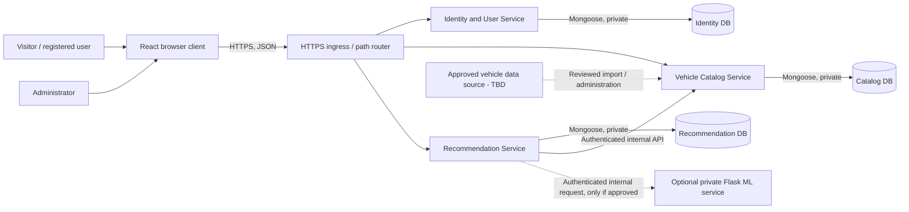
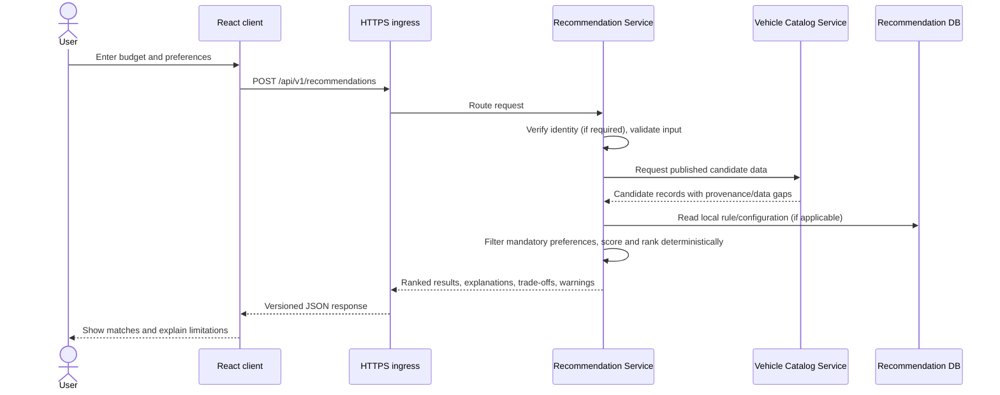
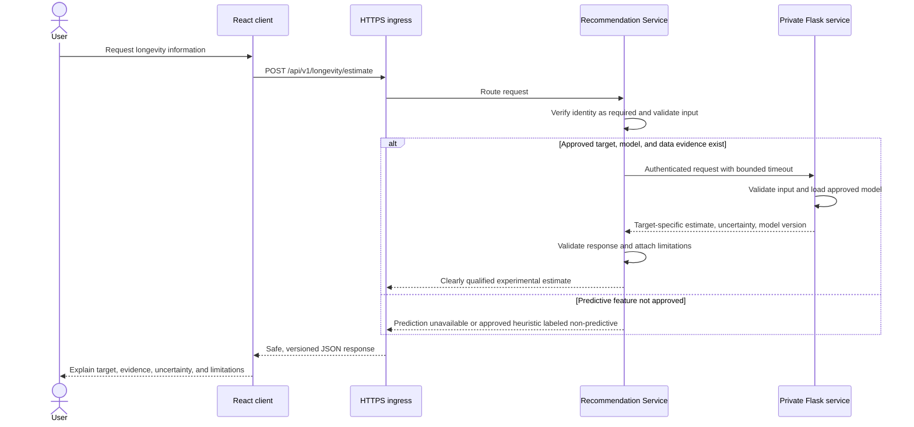

# System Architecture

**Product:** Smart Vehicle Recommendation System  
**Status:** Draft for review  
**Source documents:** `01_PRD.md`, `02_REQUIREMENTS.md`  
**Version:** 1.0

## 1. Architecture summary

The application uses a small microservices architecture. A React
browser client communicates over HTTPS with three separately deployed
Node.js/Express services:

1. **Identity and User Service:** authentication, user profiles, and
   preferences.
2. **Vehicle Catalog Service:** public catalog reads and administrator
   catalog management.
3. **Recommendation Service:** preference-based recommendations,
   comparison, and favorites.

Each service owns its database/collections. Services do not read or
write another service's collections; they use versioned APIs for
cross-service data. A separate Python/Flask ML service remains optional
and requires the evidence gate in `08_AI_ML_DESIGN.md`.

The browser must never connect directly to MongoDB or the ML service.
Core behavior must not require the ML service. The additional service
boundaries introduce network failure, deployment, and consistency
concerns that are addressed below.

## 2. System context

### Actors and external systems

- **Visitor:** Searches the public catalog, views vehicle details, and
  may compare vehicles or submit preferences.
- **Registered user:** Also manages their own profile, preferences, and
  saved vehicles.
- **Administrator:** Uses protected catalog-management capabilities.
- **Browser client:** React application; no privileged credentials.
- **Identity and User Service:** Node.js/Express service and its owned
  MongoDB database.
- **Vehicle Catalog Service:** Node.js/Express service and its owned
  MongoDB database.
- **Recommendation Service:** Node.js/Express service and its owned
  MongoDB database.
- **Optional ML API:** Private Flask service called only by the
  Recommendation Service.
- **Catalog data source:** Not yet selected; records must preserve
  provenance and data-quality state.

### System context diagram

The catalog source and its licensing are not assumed. Data may be
entered or imported only through an approved and auditable workflow.
The ingress is a routing/deployment boundary, not an additional
business-domain service; no service mesh or API-management platform is
assumed.

## 3. Component architecture

### Frontend: React and Tailwind CSS

Responsibilities:

- Render responsive pages, forms, recommendation explanations, and
  comparison results.
- Perform convenient client-side input feedback while relying on the
  backend for authoritative validation and authorization.
- Call only the public application API.
- Represent missing, unknown, and unverified information distinctly.
- Never calculate authoritative recommendation scores or longevity
  estimates.
- Never contain database credentials, JWT signing secrets, or
  ML-service credentials.

Suggested frontend areas:

- `app`: application bootstrap and route composition.
- `pages`: discovery, detail, questionnaire, results, compare, account,
  favorites, and admin views.
- `components`: shared forms, vehicle cards, filters, score explanation,
  specification tables, and feedback states.
- `features`: user-facing feature composition/state.
- `services/api`: typed API client and request/error handling.
- `types`: API-facing data contracts.

Exact folder structure is to be decided during the implementation-plan
and repository setup milestones.

### Node.js / Express domain services

Each service is an independently deployable application with its own
routes, domain logic, persistence adapter, configuration, health
endpoint, tests, and versioned API contract. The split is intentionally
limited to the three user-selected service boundaries.

| Service | Owns | Data ownership |
|---|---|---|
| **Identity and User Service** | Registration, login/logout, token/session validation, account roles, user profile, and user preferences | User accounts, password hashes, roles, profiles, and saved preferences |
| **Vehicle Catalog Service** | Public vehicle listing/details/search; admin-only create, update, publish, unpublish, and delete operations | Vehicle specifications, prices, publication state, provenance, and verification metadata |
| **Recommendation Service** | Preference submission, eligibility/ranking/explanations, comparison orchestration, favorites, and optional recommendation history | Favorites, comparison/recommendation records if enabled, and recommendation rule version/configuration |

All services validate requests independently. Each service enforces
authorization for its own resources. Recommendation scoring remains
deterministic and server-side in the Recommendation Service.

### Persistence: service-owned MongoDB databases

- Each domain service owns its MongoDB database/collections and is the
  only writer/reader of those collections.
- No service performs cross-service joins or directly accesses another
  service's database, even if databases share a physical MongoDB Atlas
  cluster.
- Use separate database credentials/roles so a compromised service
  cannot read or modify another service's data.
- Mongoose models and indexes enforce persistence constraints alongside
  request validation.
- The Catalog Service owns vehicle specifications, distinct INR price
  types, provenance, and verification state; missing values are not
  fabricated.
- The Identity Service protects account and role fields from client
  mass assignment.
- The Recommendation Service owns favorite relationships and can store
  a vehicle identifier plus minimal display snapshot only if that
  snapshot policy is approved. Current vehicle truth comes from the
  Catalog Service API.
- Training labels, maintenance history, and observations remain
  distinct from catalog specifications and must have an explicit owner
  before being stored.

Cross-service API contracts and per-service collection ownership will
be detailed in `04_DATABASE_DESIGN.md` and `05_API_SPECIFICATION.md`.

### Optional ML service: Python / Flask

- A separately deployable service only when the target, data, and model
  are approved.
- Does not expose a browser-facing endpoint.
- Accepts requests only from the Recommendation Service over a private network with
  service authentication and TLS where supported by the deployment.
- Validates input independently and returns a versioned, bounded
  response.
- Loads only a reviewed model artifact; it must not silently train from
  application traffic.
- Is not required for any Must-priority feature.

Until the evidence and product approval gates are met, the API must
report prediction functionality as unavailable or use an explicitly
approved non-predictive heuristic.

## 4. Frontend-to-service communication

1. The browser loads the React application from the frontend hosting
   environment.
2. React sends HTTPS JSON requests through the configured ingress/router
   to the appropriate service API under `/api/v1`.
3. Client-side validation may improve usability, but the API repeats all
   security-, data-, and business-critical validation.
4. Authentication credentials are sent according to the approved
   token/session transport policy. Each service validates the
   credential; the acting user and roles are derived from trusted,
   verified identity claims.
5. Responses use consistent JSON data and error envelopes.
6. The frontend never sends a score and treats it as authoritative; the
   Recommendation Service generates recommendation results.

The ingress should route identity, catalog, and recommendation paths
without implementing domain behavior. Browser/API origin arrangement,
CORS allowlists, token transport, CSRF controls, and refresh/revocation
policy require approval before deployment.

## 5. Service-to-database communication

- Each Express service uses its own Mongoose models/repositories and
  private connection configuration.
- Only the owning service receives that database's URI and least-
  privilege credentials.
- Queries use allowlisted filters and bounded pagination; arbitrary
  client query operators are not accepted.
- Writes validate before persistence and enforce local uniqueness
  (including one favorite per user/vehicle in the Recommendation
  Service).
- The Catalog Service returns only published records and approved
  fields on public endpoints; administrative endpoints require admin
  identity.
- No cross-service transactions are assumed. Operations spanning service
  boundaries must use bounded API calls and explicitly documented
  compensation/retry behavior.

## 6. Service-to-service communication

- Use HTTPS for deployed service calls over a private network; local
  development may use loopback.
- The Catalog Service and Recommendation Service APIs are not directly
  reachable from the public Internet except through the configured
  ingress.
- The Identity Service issues credentials; other services validate
  signed identity tokens using issuer/audience checks and a controlled
  public-key/JWKS mechanism where supported. Do not share a signing
  secret broadly across services.
- Calls that need current vehicle details (recommendations, comparison,
  favorite display) go from the Recommendation Service to the Catalog
  Service API. Each request has a timeout and safe downstream error
  mapping.
- User preference data is owned by the Identity Service. The
  Recommendation Service may accept preferences explicitly from the
  client or retrieve them through a protected Identity Service
  endpoint; the API contract must select one behavior.
- Use versioned internal contracts, request correlation IDs, strict
  schemas, and allowlisted response fields.
- Do not add a message broker or service mesh by default. If synchronous
  APIs cannot meet an approved reliability or scale requirement, revisit
  the integration design.
- Avoid distributed transactions. For favorite creation, validate
  vehicle existence with the Catalog Service before saving the local
  favorite. If catalog data later changes or is unpublished, the
  Recommendation Service must handle stale references gracefully.

## 7. Recommendation Service-to-ML communication

The Recommendation Service is the only caller. Proposed controls:

1. Keep the Flask service on a private network or loopback in local
   development; do not publish it directly to the Internet.
2. Use service-to-service authentication (a dedicated credential or
   workload identity supported by the deployment) and TLS for network
   deployments.
3. Store credentials in server-side secret configuration; never return
   or bundle them in the frontend.
4. Apply strict request/response schemas, size limits, timeouts, and
   response validation in Node and Flask.
5. Rate-limit user-facing longevity requests at the Node boundary.
6. Log a correlation ID and safe failure category, not secrets or raw
   sensitive payloads.
7. Fail closed for the estimate itself if the service is down, while
   preserving core application behavior. Any fallback must be the
   approved non-predictive heuristic, not a success-shaped fabricated
   prediction.
8. Version the ML interface and model metadata so requests and results
   can be audited.

The exact deployment network and identity mechanism depend on the
hosting environment and are not selected in this draft.

## 8. Authentication and authorization flow

### Authentication flow

1. The user submits credentials through the React client over HTTPS.
2. The Identity Service validates the request and checks credentials
   against the stored password hash.
3. On success, the Identity Service issues or establishes the approved JWT-backed
   session.
4. Subsequent protected requests provide the credential through the
   approved transport.
5. Each service verifies signature, issuer, audience, expiry, and
   applicable revocation state. Services enforce their own role and
   ownership rules.
6. Logout invalidates or clears the credential through the Identity
   Service according to the
   selected session design.

### Authorization rules

- Public catalog reads do not imply permission to view unpublished
  records.
- Users can access and modify only their own profile, preferences,
  favorites, and optional history.
- Administrative APIs check an administrator role at the backend for
  every operation.
- Role and ownership values supplied in request bodies are never
  authoritative.
- Invalid, expired, or missing credentials cannot access protected
  operations.

Selected browser transport: short-lived JWT in a `Secure`, `HttpOnly`,
`SameSite=Lax`, `Path=/` cookie (use the `__Host-` prefix in production;
do not set a `Domain` attribute). Cookie-authenticated state-changing
requests require CSRF protection. Production requires HTTPS. Local
development may use a clearly separated non-production cookie setting.
Access-token expiry, refresh-token lifecycle, revocation, and signing-key
rotation are finalized with the Identity Service implementation and
documented in its configuration.

## 9. Error propagation

1. Each service validates its inputs and returns the common API error
   envelope with safe field details.
2. Domain errors (not found, conflict, forbidden, empty result) map to
   documented status codes and stable error codes.
3. Database exceptions are logged safely by the owning service; driver
   messages and stack traces are not returned to clients.
4. Inter-service and ML errors map to downstream-unavailable,
   timeout, or invalid-response categories. They do not fail unrelated
   services or endpoints.
5. Each request and internal call should propagate a correlation ID.
6. Empty catalog/recommendation results are successful responses, not
   service errors.
7. Retries are limited to idempotent operations or requests protected
   by an idempotency key; avoid automatic retries that duplicate writes.

## 10. Configuration and environment variables

Names are illustrative until the environment schema is finalized.
Values must never be committed as secrets.

| Variable | Used by | Purpose |
|---|---|---|
| `NODE_ENV` | Each Node service | Runtime mode |
| `PORT` | Each service | Listen port |
| `CLIENT_ORIGIN` | Ingress / services as needed | Explicit browser-origin allowlist |
| `IDENTITY_MONGODB_URI` | Identity Service | Private URI for the identity-owned database |
| `CATALOG_MONGODB_URI` | Catalog Service | Private URI for the catalog-owned database |
| `RECOMMENDATION_MONGODB_URI` | Recommendation Service | Private URI for the recommendation-owned database |
| `JWT_SIGNING_KEY` or approved key reference | Identity Service | Signing key; never distributed to other services |
| `JWT_ISSUER`, `JWT_AUDIENCE`, `JWT_TTL` | All Node services | Token validation/configuration, if selected |
| `IDENTITY_JWKS_URL` or public-key configuration | Other Node services | Trusted public-key discovery for token validation |
| `CATALOG_SERVICE_URL` | Recommendation Service | Private catalog API base URL |
| `IDENTITY_SERVICE_URL` | Recommendation Service | Private identity API base URL, if preference retrieval is selected |
| `SERVICE_AUTH_CONFIGURATION` | Internal callers | Service-to-service authentication configuration |
| `ML_SERVICE_URL` | Recommendation Service | Private ML endpoint; omitted/disabled until approved |
| `ML_SERVICE_CREDENTIAL` or identity configuration | Recommendation Service | Server-to-server authentication, if required |
| `ML_REQUEST_TIMEOUT_MS` | Recommendation Service | Upper bound for optional ML calls |
| `LOG_LEVEL` | Each service | Logging verbosity |
| `FLASK_ENV` | Flask service | Flask runtime mode, if service is enabled |
| `MODEL_ARTIFACT_PATH` | Flask service | Approved read-only model artifact location |
| `MODEL_VERSION` | Flask service | Model identifier returned with estimates |

The exact required/optional status and validation of each variable must
be specified in deployment documentation. Missing required server
configuration must fail clearly at startup, not fall back to insecure
defaults.

## 11. Logging and monitoring

- Use structured logs for each service's API errors, authorization
  denials, downstream failures, and health.
- Propagate request correlation IDs across ingress and internal calls.
- Never log passwords, bearer tokens, cookie contents, signing secrets,
  database credentials, ML credentials, or unnecessary personal data.
- Record administration changes in an audit trail only after its scope,
  retention, and access policy are approved.
- Expose per-service health/readiness checks without disclosing
  environment values, model contents, or database secrets.
- ML health is separately observable; its unavailability does not imply
  the domain services are unhealthy if their required dependencies are
  ready.

## 12. Deployment boundaries

### Baseline services

- **Frontend:** Static React assets delivered by a static host or the
  selected application hosting setup.
- **Ingress/router:** HTTPS entry point routing public paths to the
  appropriate domain service; it contains no domain logic.
- **Identity and User Service:** Independently deployed Node.js API.
- **Vehicle Catalog Service:** Independently deployed Node.js API.
- **Recommendation Service:** Independently deployed Node.js API.
- **Databases:** One logical MongoDB database/credential boundary per
  service, with private/controlled access.
- **Optional ML:** One private Flask deployment only after approval.

No additional business microservices, queue, cache, service mesh, or
orchestration platform is introduced absent a documented operational
requirement. The ingress may be provided by the selected hosting
platform; it is not assumed to be a separate custom application.

## 13. Development and production environments

### Development

- Developers may run React and each Node service locally, with service
  ports/URLs configured explicitly.
- Use isolated development/test databases for each service, never
  production data.
- Keep `.env` files out of version control; provide a sanitized
  `.env.example` with names and descriptions only.
- Use clearly marked, synthetic fixtures only for UI and tests; never
  label them as verified real vehicle data.
- If ML integration is not approved, omit/disable the Flask service and
  ML routes.
- Local inter-service calls use loopback and non-production credentials.

### Production

- Require HTTPS for browser/API and service-to-service traffic.
- Use managed secret injection, least-privilege per-service database
  access, and explicit CORS/origin configuration.
- Do not expose databases or the ML service publicly. Domain services
  are reachable through approved ingress and private service networking.
- Deploy and roll back services independently; ensure API compatibility
  during rolling updates.
- Use real vehicle data only after source permission and verification
  rules are established.
- Apply request limits, rate limits, safe logs, health checks, and
  tested backups/restore procedures appropriate to the host.
- Enable model functionality only after data governance, evaluation,
  security, and product approval.

## 14. Recommendation request data flow

Recommendation scores are calculated in the backend. Optional
recommendation history is not persisted unless separately approved.

## 15. Longevity estimation data flow

The ML service is optional and private. A timeout or malformed
downstream response must not become a fabricated prediction.

## 16. Architecture decisions and trade-offs

| Decision | Rationale | Trade-off / status |
|---|---|---|
| Three domain microservices | User-selected split: identity/users, catalog/admin, and recommendations/comparison/favorites. | Independent deployments add operational complexity, network failures, API compatibility, and distributed data consistency concerns. |
| Database ownership per service | Prevents coupling through shared collections and supports least privilege. | Cross-service reads use APIs; no cross-service joins or atomic transactions. |
| HTTPS ingress/router | Provides one controlled external entry path without an additional domain service. | Production host remains undecided; local development uses the Vite proxy. |
| Secure HttpOnly cookie | Reduces browser JavaScript access to the authentication credential; CSRF controls are required. | Requires same-site routing and explicit cookie/CSRF configuration. |
| Separate ML runtime, if used | Python/scikit-learn tooling differs from Node services. | Additional private service and failure modes; optional and gated. |
| Backend-only database access | Protects credentials and centralizes validation/authorization. | Every client operation must go through the owning service API. |
| Rule-based recommendations first | Deterministic, explainable, and does not require training data. | Initial weights are product hypotheses, not validated quality claims. |
| No message broker or service mesh initially | Keeps the portfolio implementation manageable; current cross-service flows can use bounded synchronous APIs. | Revisit only if approved reliability/scale needs cannot be met synchronously. |
| ML is not an MVP dependency | No approved target or suitable labeled data is supplied. | Longevity prediction may be omitted; honest non-predictive fallback remains an approval decision. |

## 17. Decisions requiring approval before implementation

1. **Authentication lifecycle:** Cookie transport is selected. Define
   access expiry, refresh/revocation, and public-key rotation before
   authentication implementation.
2. **Ingress implementation:** Select the hosting platform's router or
   an approved ingress product and define public path exposure.
3. **Inter-service authentication:** Select service identity,
   credential rotation, and timeout/retry policies.
4. **Data ownership details:** Confirm the logical database per service,
   whether databases share a physical cluster, and the minimal vehicle
   snapshot (if any) stored with favorites/history.
5. **ML deployment and identity:** Private network and credential/workload
   identity mechanism, if the ML service is approved at all.
6. **Hosting topology:** Same-origin frontend/API versus separate
   origins, and the selected production host.
7. **Catalog source and import approach:** Authorized provider/manual
   administration, update cadence, and audit requirements.
8. **Recommendation policy:** Mandatory preference fields, scoring
   weights, missing-data treatment, and tie-breaks.
9. **Data lifecycle:** User profile/favorite deletion behavior and
   whether optional recommendation history or administration audit logs
   are retained.
10. **Longevity scope:** Omit predictions until qualified data is
   available, and separately decide whether a non-predictive heuristic
   belongs in the MVP.

## 18. Review gate

The service split and per-service database ownership reflect the user's
selection. Review and approve this revised architecture before
finalizing per-service database schemas and API contracts. Unresolved
security, hosting, and data decisions must remain visible in those
documents rather than being silently assumed.
